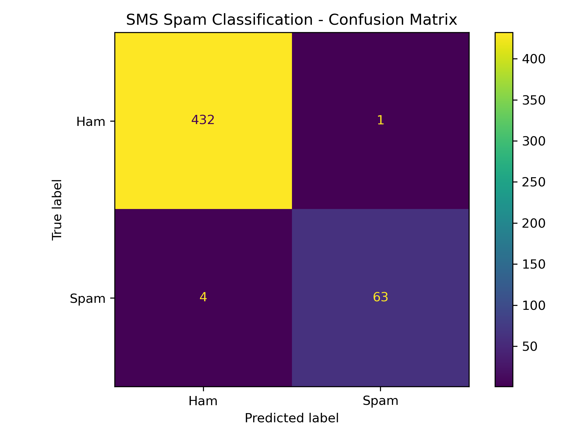

# SMS Spam Detection Using BERT

A transformer-based text classification project that identifies SMS messages as **HAM (legitimate)** or **SPAM (unwanted or potentially fraudulent)** using a fine-tuned BERT model. The project includes automated dataset downloading, text preprocessing, class-weighted training, evaluation, and interactive prediction.

**Author:** Chaitanya
**GitHub:** [@chaitu4206](https://github.com/chaitu4206)
**Repository:** [Spam-Detection](https://github.com/chaitu4206/Spam-Detection)

## Overview

SMS spam can contain unwanted advertisements, suspicious links, and fraudulent messages. This project fine-tunes the pretrained `bert-base-uncased` model to classify SMS messages into two categories.

### Features

- Automatic download and extraction of the SMS Spam Collection dataset
- Stratified dataset sampling and train-validation-test splitting
- Text normalization for URLs, email addresses, phone numbers, and whitespace
- BERT tokenization with a maximum sequence length of 128
- Class-weighted cross-entropy loss to address class imbalance
- Best-model selection using validation macro F1-score
- Classification report and confusion matrix generation
- Interactive command-line SMS classification
- Model-weight storage through Git Large File Storage (Git LFS)

## Model Performance

The saved classification report records the following results on a test set of 500 messages.

| Metric | HAM | SPAM |
|---|---:|---:|
| Precision | 99.08% | 98.44% |
| Recall | 99.77% | 94.03% |
| F1-score | 99.42% | 96.18% |
| Test support | 433 | 67 |

| Overall metric | Result |
|---|---:|
| Accuracy | 99.00% |
| Macro F1-score | 97.80% |
| Weighted F1-score | 98.99% |

The model correctly classified 495 of the 500 test messages according to the saved report.

**Interpretation:** The model achieved high precision and recall for legitimate messages and detected approximately 94% of spam messages in this test set. Performance on new messages may differ, particularly when message patterns differ from the training dataset.

### Confusion Matrix

The confusion matrix uses HAM as class 0 and SPAM as class 1.

| Actual / Predicted | HAM | SPAM |
|---|---:|---:|
| HAM | 432 | 1 |
| SPAM | 4 | 63 |

The model incorrectly classified one legitimate message as spam and missed four spam messages in the saved evaluation results.



## Technology Stack

- **Language:** Python
- **Deep learning:** PyTorch
- **Transformer model:** Hugging Face Transformers, BERT
- **Dataset utilities:** Hugging Face Datasets
- **Data processing:** Pandas, NumPy
- **Machine learning utilities:** Scikit-learn
- **Visualization:** Matplotlib
- **Version control:** Git and Git LFS

## Project Structure

```text
Spam-Detection/
├── dataset.py
├── preprocessing.py
├── train.py
├── evaluate.py
├── inference.py
├── requirements.txt
├── .gitignore
├── .gitattributes
├── models/
│   └── spam_bert/
│       ├── config.json
│       ├── model.safetensors
│       ├── tokenizer.json
│       ├── tokenizer_config.json
│       └── training_args.bin
└── results/
    └── spam/
        ├── classification_report.txt
        └── confusion_matrix.png
```

The `data/` directory is created locally when the dataset is downloaded. Generated test predictions are saved to `results/spam/test_predictions.csv` and excluded from version control.

## Dataset

This project uses the **SMS Spam Collection** dataset from the UCI Machine Learning Repository.

- Dataset page: [UCI SMS Spam Collection](https://archive.ics.uci.edu/dataset/228/sms+spam+collection)
- Download URL: [SMS Spam Collection ZIP](https://archive.ics.uci.edu/static/public/228/sms+spam+collection.zip)

The dataset contains SMS messages labeled as legitimate (`ham`) or spam.

### Label Mapping

| Original label | Numeric label | Meaning |
|---|---:|---|
| `ham` | 0 | Legitimate message |
| `spam` | 1 | Spam message |

The `dataset.py` script downloads and extracts the dataset into `data/spam/` when the extracted data file is not already present.

### Dataset Preparation

The training pipeline:

1. Loads the tab-separated SMS dataset.
2. Removes missing records and maps labels to numeric values.
3. Selects up to 5,000 records using stratified sampling with random state 42.
4. Splits the selected records into training, validation, and test sets using stratification.

The intended split is 80% training, 10% validation, and 10% testing. With 5,000 records, this produces approximately 4,000 training records, 500 validation records, and 500 test records.

## Text Preprocessing

The `preprocessing.py` module provides the `clean_text()` and `preprocess_dataframe()` functions.

The preprocessing pipeline:

- Decodes HTML entities
- Replaces URLs with `HTTPURL`
- Replaces email addresses with `EMAIL`
- Replaces phone-number patterns with `PHONE`
- Normalizes repeated whitespace
- Removes leading and trailing whitespace

The cleaned text is tokenized using the pretrained BERT tokenizer. Sequences are truncated or padded to a maximum length of 128 tokens.

## Installation

### Prerequisites

- Python compatible with the pinned dependencies
- Git
- Git LFS
- Internet access for dataset downloads and pretrained-model access when needed

### 1. Clone the repository

```bash
git clone https://github.com/chaitu4206/Spam-Detection.git
cd Spam-Detection
```

### 2. Create and activate a virtual environment

Windows PowerShell:

```powershell
python -m venv .venv
.\.venv\Scripts\Activate.ps1
```

If PowerShell blocks activation, you can run the environment's Python executable directly or follow your organization's approved execution-policy instructions.

### 3. Install dependencies

```bash
python -m pip install --upgrade pip
pip install -r requirements.txt
```

The project pins these package versions:

```text
numpy==2.3.5
pandas==2.3.3
matplotlib==3.10.6
scikit-learn==1.7.2
torch==2.7.0
transformers==5.15.1
datasets==5.0.1
```

### 4. Retrieve the trained model

The final model weights are tracked using Git LFS. Install Git LFS and retrieve the files before running inference if the weights have not been downloaded.

```bash
git lfs install
git lfs pull
```

Check that `models/spam_bert/model.safetensors` contains the actual model weights rather than an LFS pointer.

## Training

To download the dataset, preprocess the messages, fine-tune BERT, and save the trained model, run:

```bash
python train.py
```

### Training Configuration

| Parameter | Value |
|---|---|
| Base model | `bert-base-uncased` |
| Maximum samples | 5,000 |
| Number of classes | 2 |
| Maximum token length | 128 |
| Training batch size | 8 |
| Evaluation batch size | 8 |
| Epochs | 2 |
| Learning rate | `2e-5` |
| Weight decay | `0.01` |
| Loss function | Class-weighted cross-entropy |
| Validation metric for best model | Macro F1-score |
| Checkpoint retention | 1 |
| Device configuration | CPU |

The training code calculates class weights from the training-label distribution and uses them in the cross-entropy loss. The best checkpoint is selected using validation macro F1-score.

The final model and tokenizer are saved to `models/spam_bert/`.

Training requires additional computation and may take longer on a CPU.

## Evaluation

Run the evaluation script after the trained model is available:

```bash
python evaluate.py
```

The script recreates the stratified dataset split, preprocesses the test set, loads the saved model, and generates predictions.

| File | Description |
|---|---|
| `results/spam/classification_report.txt` | Precision, recall, F1-score, and support |
| `results/spam/confusion_matrix.png` | Confusion matrix visualization |
| `results/spam/test_predictions.csv` | Actual and predicted labels for test messages |

The test-predictions CSV is ignored by Git to avoid committing generated output.

**Reproducibility note:** The saved metrics above describe the report currently included in this repository. If the dataset, dependency versions, model weights, or training process change, rerun evaluation and update the documented metrics only after verifying the new report.

## Interactive Inference

Run the interactive classifier:

```bash
python inference.py
```

Enter a message when prompted. Type `exit` to stop.

Example session (illustrative format; these are not recorded predictions):

```text
============================================================
SMS SPAM CLASSIFIER
============================================================

Enter an SMS message to classify.
Type 'exit' to stop.

SMS: Congratulations! You have won a prize. Click the link now.

Prediction: SPAM
Confidence: 0.XXXX

Class probabilities:
Ham: 0.XXXX
Spam: 0.XXXX
```

The actual prediction and probabilities depend on the loaded model and input message.

### Use the Prediction Function in Python

```python
from inference import predict

message = "Congratulations! You have won a prize."
label, confidence, probabilities = predict(message)

print("Prediction:", label)
print("Confidence:", round(confidence, 4))
print("Probabilities:", probabilities)
```

The `predict()` function returns:

- The predicted label (`HAM` or `SPAM`)
- The predicted class confidence
- A probability list ordered as HAM, then SPAM

Confidence is the model's softmax probability, not a guarantee that the prediction is correct.

## Limitations

- The project uses a limited sample of the full dataset for training.
- The dataset may not represent all modern spam tactics, languages, or messaging platforms.
- High overall accuracy can hide errors in the less frequent spam class, so spam recall and the confusion matrix are also important.
- The model is a text classifier, not a complete security or fraud-detection system.
- Predictions should not be treated as definitive proof that a message is safe or malicious.

## Future Improvements

- Evaluate on newer and independently collected SMS messages.
- Test robustness against obfuscated links and adversarial text.
- Compare BERT with simpler baseline classifiers.
- Add a web interface or API for predictions.
- Track model versions and evaluation metrics across experiments.
- Add automated tests for preprocessing and inference.

## Author and Repository

Created and maintained by **Chaitanya**.

- **GitHub profile:** [chaitu4206](https://github.com/chaitu4206)
- **Project repository:** [chaitu4206/Spam-Detection](https://github.com/chaitu4206/Spam-Detection)

## License

No license file was identified in the inspected project files. Add a `LICENSE` file before describing the project as open source under a particular license.
